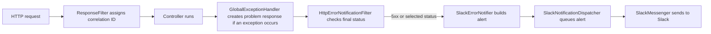
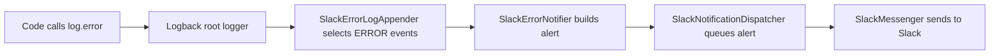

# How error handling and Slack alerts work

This guide explains the library from the point of view of an application that uses it. You do not need to know Spring filters or Logback before reading it.

## What changed from the earlier library?

The earlier library already turned controller exceptions into problem responses with a correlation ID. It logged every handled exception at `ERROR`, including 4xx responses, and it did not send Slack alerts. The current code keeps the same response structure, logs ordinary 4xx exceptions at `WARN`, and can send Slack alerts when an application opts in. The new Slack code has two ways to find an alert: inspect an HTTP response or listen for a general `ERROR` log event.

## The three outputs

When something goes wrong during an HTTP request, three different people or systems may need information:

1. **The API caller** receives an HTTP status and a JSON *problem detail*. The response includes a correlation ID, which the caller can give to someone investigating the failure.
2. **The application logs** record what happened. A 4xx exception is logged at `WARN` with its type and details; its stack trace is available at `DEBUG`. A 5xx exception is logged at `ERROR` with a stack trace.
3. **The Slack channel** can receive an alert when Slack is enabled. HTTP 5xx responses and selected additional statuses qualify. Other `ERROR` log events also qualify.

An alert is an extra notification. It does not replace the HTTP response or the normal logs.

## A few terms

| Term | Meaning here |
| --- | --- |
| **Exception** | A Java object that says a piece of code failed. |
| **HTTP status** | The number in the response, such as `404`, `429`, or `500`. A 4xx usually describes a request that cannot be fulfilled; a 5xx describes a server failure. |
| **Filter** | Code that runs around an HTTP request. It can inspect the response after the controller finishes. |
| **Correlation ID** | One ID shared by the response, request logs, and HTTP Slack alert, so they can be matched. |
| **Log event** | One call such as `log.warn(...)` or `log.error(...)`. |
| **Appender** | Logback's name for code that receives log events. The console appender prints them; this library's appender selects events for Slack. |
| **Auto-configuration** | Spring Boot creating and connecting the library's error handling components, plus Slack components when enabled. |

## What happens for an HTTP failure?



[`ResponseFilter.doFilterInternal`](../src/main/java/no/fintlabs/ResponseFilter.java) sets `X-Correlation-Id` and makes a small JSON request body available to error logging. If a controller throws an exception, [`GlobalExceptionHandler.handleAll`](../src/main/java/no/fintlabs/controller/GlobalExceptionHandler.java) asks [`ProblemDetailFactory.createProblemDetail`](../src/main/java/no/fintlabs/ProblemDetailFactory.java) to build the response and records the exception and correlation ID on the request. After the request finishes, [`HttpErrorNotificationFilter.doFilterInternal`](../src/main/java/no/fintlabs/common/HttpErrorNotificationFilter.java) checks the response status. It uses those request details when it has them, and sends at most one HTTP alert for that request.

### Correlation ID and request body

`ResponseFilter` runs at `HIGHEST_PRECEDENCE + 10`. [`CorrelationId.getOrCreate`](../src/main/java/no/fintlabs/CorrelationId.java) reuses an ID already stored on the request, uses the current Micrometer trace ID when available, or generates a UUID. The filter writes it to the response header and MDC key `correlationId`, then restores the previous MDC value in `finally` so it does not leak into later work on the same thread:

```java
String correlationId = CorrelationId.getOrCreate(request, tracer);
MDC.put(CorrelationId.LOGGING_CONTEXT_KEY, correlationId);
response.setHeader("X-Correlation-Id", correlationId);
chain.doFilter(requestBodyLogging.cacheRequest(request), response);
```

[`RequestBodyLogging.cacheRequest` and `format`](../src/main/java/no/fintlabs/RequestBodyLogging.java) support the handler's `requestBody` log field. They cache JSON bytes as the controller reads them; they do not read the body merely to log it. Only a parsed JSON object or array of at most 8,192 bytes is logged. Non-JSON, oversized, unread, empty, or invalid bodies get a placeholder. The controller still receives the complete input. The boundary and unread-body cases are covered by [`RequestBodyLoggingTest`](../src/test/java/no/fintlabs/RequestBodyLoggingTest.java).

### Exception mapping and problem details

`ProblemDetailFactory` preserves the body supplied by an exception implementing Spring's `ErrorResponse`. Otherwise it gets the status and type from [`KontrollException`](../src/main/java/no/fintlabs/exception/KontrollException.java) or [`ExceptionMappingRegistry`](../src/main/java/no/fintlabs/ExceptionMappingRegistry.java); unmapped exceptions become `500` with type `https://fintlabs.no/errors/internal-server-error`. In either case the factory adds the request URI as `instance`, plus `correlationId`, `applicationId`, and `timestamp`.

For example, [`ConflictException`](../src/main/java/no/fintlabs/exception/ConflictException.java) supplies status `409` and type identifier `conflict`, producing this response shape for a request to `/assignments`:

```json
{
  "type": "https://fintlabs.no/errors/conflict",
  "title": "Conflict",
  "status": 409,
  "detail": "Already assigned",
  "instance": "/assignments",
  "correlationId": "<trace ID or UUID>",
  "applicationId": "<fint.application-id>",
  "timestamp": "<ISO-8601 instant>"
}
```

The handler stores the exception and ID in request attributes for the notification filter. It logs method, path, status, ID, exception class, detail, and formatted request body. Statuses below `500` get a `WARN` without a stack trace and a separate `DEBUG` stack trace; statuses `500` and above get an `ERROR` with a stack trace. See [`GlobalExceptionHandlerTest`](../src/test/java/no/fintlabs/controller/GlobalExceptionHandlerTest.java) for the response, log, and ID assertions.

### Final status and alert selection

`HttpErrorNotificationFilter` runs at `LOWEST_PRECEDENCE` and checks the final status even if no exception was thrown. If downstream code throws an `Exception` through this filter, it logs and alerts that exception as HTTP `500`, then rethrows it. A request attribute prevents a second HTTP alert, including on an asynchronous dispatch. [`SlackErrorNotifier.shouldNotifyForHttpStatus`](../src/main/java/no/fintlabs/slack/SlackErrorNotifier.java) makes the decision:

```java
return status >= 500 || additionalHttpStatuses.contains(status);
```

If the handler supplied an exception, the alert includes its class and message. Otherwise the filter logs the qualifying status and sends an alert with method and path. The notifier uses the handler's correlation ID request attribute or the MDC value when available. [`HttpErrorNotificationFilterTest`](../src/test/java/no/fintlabs/common/HttpErrorNotificationFilterTest.java) covers status-only responses and a thrown downstream exception.

The HTTP filter runs late in the filter chain. A response produced by an earlier filter, such as a security rejection, may not reach it. This is part of the current design.

**Examples with Slack enabled:**

| Result | Log | Slack |
| --- | --- | --- |
| `409 Conflict`, selected by default | `WARN` with context | One HTTP alert |
| `429 Too Many Requests`, selected by default | `WARN` with context | One HTTP alert |
| `500 Internal Server Error` | `ERROR` with stack trace | One HTTP alert |

The selected status list is configurable. Setting it to `[404, 429]` **replaces** the default `429`, `422`, and `409`; it does not add to them. A configured 4xx can therefore alert while still being logged at `WARN`.

## What happens for an ordinary `ERROR` log?

An error can happen outside an HTTP request, for example in a scheduled job. There is no HTTP response for the request filter to inspect. The library handles this through Logback:



[`SlackLoggingSetup.connectSlackAlertsToLogging`](../src/main/java/no/fintlabs/slack/SlackLoggingSetup.java) connects [`SlackErrorLogAppender`](../src/main/java/no/fintlabs/slack/SlackErrorLogAppender.java) to Logback's root logger on `ApplicationReadyEvent`. It avoids adding the appender twice and removes its own appender when the application stops. It **sets up the connection**; it does not send messages itself.

The appender ignores `WARN` and lower levels. It also ignores `ERROR` events marked [`SLACK_NOTIFIED_DIRECTLY`](../src/main/java/no/fintlabs/slack/SlackNotificationMarkers.java). The HTTP handler and filter put that marker on their own 5xx logs because the HTTP filter sends a more useful alert with the status, request path, and correlation ID. This prevents a second Slack message for the same log event. A separate unmarked `log.error(...)` call remains eligible for a log alert.

[`SlackErrorNotifier.notifyErrorLog`](../src/main/java/no/fintlabs/slack/SlackErrorNotifier.java) includes the logger name, formatted message, up to 3,000 characters of stack trace, and any `correlationId` in the log event's MDC. Its Grafana link does not search that ID, even when the Slack message displays it. [`SlackErrorNotifierTest`](../src/test/java/no/fintlabs/slack/SlackErrorNotifierTest.java) checks the link's time range and filters.

## Why is there a queue?

Sending to Slack involves a network call. [`SlackNotificationDispatcher.dispatch`](../src/main/java/no/fintlabs/slack/SlackNotificationDispatcher.java) puts a completed message into a queue, and one background worker sends it. The request or logging thread does not wait for Slack's response.

The queue holds at most 256 waiting messages. If it fills or is shutting down, new alerts are dropped; a `WARN` log reports the first drop and every hundredth drop. On shutdown, the worker gets up to five seconds to finish. This keeps slow Slack calls from tying up application work, at the cost of possibly losing alerts during a large burst or shutdown.

[`SlackMessenger.sendErrorMessage` and `sendMessage`](../src/main/java/no/fintlabs/slack/SlackMessenger.java) prefix the alert with the application ID and, when configured, the authorized organization ID. They POST a [`SlackMessage`](../src/main/java/no/fintlabs/slack/SlackMessage.java) containing `channel` and `text` with bearer authentication. The messenger checks the [`ok` field](../src/main/java/no/fintlabs/slack/SlackApiResponse.java) in Slack's response and logs a warning for a missing token, rejected response, or failed call. The client has a two-second connection timeout and a three-second read timeout, set in [`SlackErrorNotificationAutoConfiguration`](../src/main/java/no/fintlabs/slack/SlackErrorNotificationAutoConfiguration.java). Failed sends are logged and not retried.

## How is it turned on?

Slack is **off by default**. The application enables it with `fint.kontroll.slack.enabled=true`. Put the bot token and Slack channel ID in the consuming application's 1Password secret, then expose them as environment variables and map them to `bot-token` and `channel-id` as shown in the [README example](../README.md#slack-error-notifications). A Grafana URL can also be configured to add investigation links. Set `fint.kontroll.slack.grafana-namespace` to the application's deployment namespace so those links search the right logs. The bot needs `chat:write` permission and access to the selected channel.

Spring Boot finds [`ErrorHandlingAutoConfiguration`](../src/main/java/no/fintlabs/ErrorHandlingAutoConfiguration.java) and [`SlackErrorNotificationAutoConfiguration`](../src/main/java/no/fintlabs/slack/SlackErrorNotificationAutoConfiguration.java) through [`AutoConfiguration.imports`](../src/main/resources/META-INF/spring/org.springframework.boot.autoconfigure.AutoConfiguration.imports) in the library jar. The first registers the exception handler, problem factory, request logging helper, and correlation filter for servlet applications. When Slack is enabled, the second creates the notifier, queue, HTTP filter, messenger, and logging setup (when Logback is present). If Slack is disabled, those alerting components are not created; the problem responses and ordinary logging still work.

| Property | Use and default |
| --- | --- |
| `fint.application-id` | Application ID in problem responses and alerts. [`ProblemDetailFactory`](../src/main/java/no/fintlabs/ProblemDetailFactory.java) reads this property directly. |
| `fint.kontroll.slack.enabled` | Enables Slack components; default `false`. |
| `fint.kontroll.slack.bot-token` | Bearer token; empty by default. |
| `fint.kontroll.slack.channel-id` | Destination channel; required when Slack is enabled. Supply from the 1Password secret. |
| `fint.kontroll.slack.additional-http-statuses` | Extra alert statuses; default `429`, `422`, and `409`. A supplied list replaces those values. |
| `fint.kontroll.slack.grafana-url` | Optional dashboard URL. Alerts omit the investigation link when it is empty. |
| `fint.kontroll.slack.grafana-namespace` | Namespace used in Grafana filters; falls back to `POD_NAMESPACE`, then an empty string. |

The property bindings come from [`SlackErrorNotificationAutoConfiguration`](../src/main/java/no/fintlabs/slack/SlackErrorNotificationAutoConfiguration.java) and [`SlackMessenger`](../src/main/java/no/fintlabs/slack/SlackMessenger.java). Spring fails to create the Slack components if the bot token or channel ID is absent while Slack is enabled.

When configured, the Grafana link in an HTTP alert searches around the error time and includes the correlation ID. For a general `ERROR` log alert, it links to a shorter time window without a correlation search. Both use the configured application ID and namespace. Alerts sent without a Grafana URL contain no investigation link.

## Where to read more

- [Spring MVC filters](https://docs.spring.io/spring-framework/reference/web/webmvc/filters.html): how code can run before and after a request.
- [Spring MVC controller advice](https://docs.spring.io/spring-framework/reference/web/webmvc/mvc-controller/ann-advice.html) and [problem responses](https://docs.spring.io/spring-framework/reference/web/webmvc/mvc-ann-rest-exceptions.html): how exceptions become HTTP responses.
- [Spring Boot auto-configuration](https://docs.spring.io/spring-boot/reference/features/developing-auto-configuration.html): how a library can set itself up when added to an application.
- [Logback appenders](https://logback.qos.ch/manual/appenders.html): what an appender receives and does with log events.
- [Slack `chat.postMessage`](https://docs.slack.dev/reference/methods/chat.postMessage/): the API call used to send alerts.
